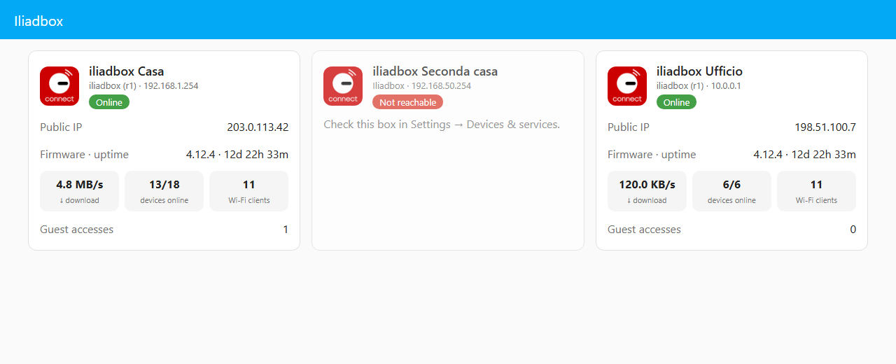
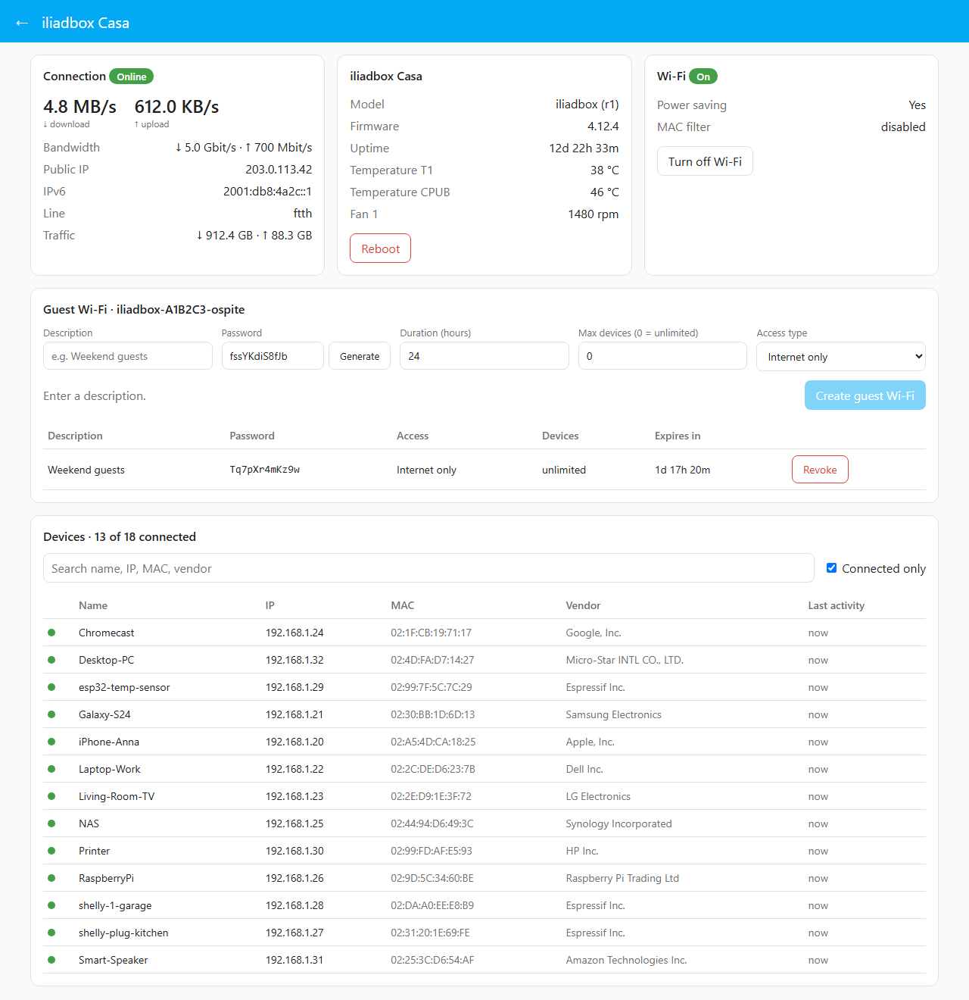
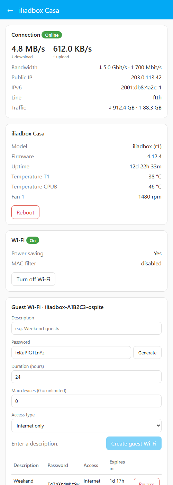
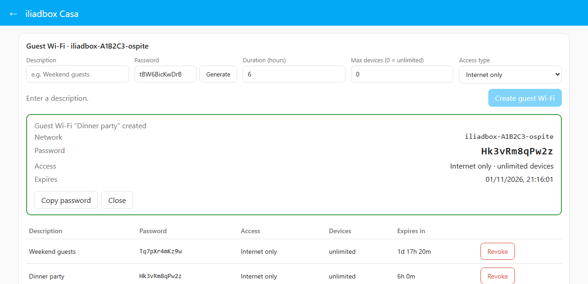

# Iliadbox for Home Assistant

[](https://hacs.xyz/docs/faq/custom_repositories)
[](https://github.com/Bassysta/ha-iliadbox/actions/workflows/validate.yml)

Custom integration for the **Iliadbox** (the Italian Iliad router, a rebranded Freebox). It talks to the box through the Freebox OS API **over the local network only**, with no cloud account and no external Python libraries.



## Features

- **Sensors**: internet connection state, download/upload rate, line bandwidth, transferred data, public IPv4/IPv6, line type, uptime, temperatures, fan speed.
- **Presence detection**: every device seen on the LAN becomes a Home Assistant **device** with a `device_tracker` (`home` / `not_home`), ready for automations.
- **Controls**: Wi-Fi on/off switch, reboot button.
- **Guest Wi-Fi**: create and revoke guest accesses with description, password, duration, max devices and access type. Available from the panel, from a button and as actions for automations.
- **Sidebar panel**: one page with connection, box status, Wi-Fi, guest accesses and the searchable device list.
- **Configurable logging**: Error / Info / Debug, switchable from the UI without restarting.

## Requirements

- Home Assistant **2024.11** or newer.
- An Iliadbox (see the tested versions below).
- Home Assistant must run **on the same local network as the box** (see below).
- Physical access to the box once, to accept the authorization request on its display.

### Tested with

| Item | Version |
|---|---|
| Box model | iliadbox (r1), `ibxgw8-r1` (`FreeboxServer8,1`) |
| Box firmware | 4.12.4 |
| Freebox OS API | **16.1** (`/api/v16/`) |

The integration reads the API version from the box (`/api_version`) and uses the major version it reports, so other Iliadbox models and firmware are expected to work as long as they expose the same endpoints. If you run it on a different model or API version, please open an issue with your `/api_version` output.

## Local network connection

The integration connects **only to the local IP address of the box**, e.g. `http://192.168.1.254`. It does not use the Iliad cloud, remote access or the `*.ibxos.it` domain, and it does not need any port forwarding.

- **Default address**: `192.168.1.254`, port `80`. If you changed the LAN subnet in the box settings, use the box address on your network (for example `192.168.17.1`). It is the gateway address of any device connected to the box.
- **Same network**: Home Assistant must reach the box directly, i.e. be connected to the Iliadbox LAN (cable or Wi-Fi) or to a network routed to it. The Freebox OS API also refuses some requests coming from outside the LAN.
- **HTTP or HTTPS**: see the next section.
- **No settings to enable on the box**: the local API is on by default, also after a factory reset.

### HTTP or HTTPS

| Mode | Settings | When to use |
|---|---|---|
| HTTP (default) | port `80`, *Use HTTPS* off | Simplest. Traffic on the LAN is not encrypted. |
| HTTPS, self-signed accepted | port `443`, *Use HTTPS* on, *Verify the certificate* **off** | Encrypted traffic when connecting by **local IP**. Recommended for HTTPS. |
| HTTPS, verified | port `443`, *Use HTTPS* on, *Verify the certificate* **on** | Only with a hostname that matches the box certificate and is trusted by Home Assistant. |

Why verification usually has to be off on the LAN: the box certificate is issued for a **hostname**, never for the local IP. Depending on the name used it is signed by Iliad's own authority (*Iliadbox ECC Root CA*, not trusted by Home Assistant) or, if you set up a personal remote-access domain, by Let's Encrypt for that domain. Connecting to `192.168.x.x` therefore never matches the certificate name. With verification off the traffic is still encrypted, but the box identity is not checked.

When *Use HTTPS* is on and the port is left at `80`, the integration switches to `443` automatically. If verification fails during setup, the form shows *The box certificate could not be verified*: turn off *Verify the certificate* and submit again.

To change address, port or HTTPS later: **Settings → Devices & services → Iliadbox → Configure** (or ⋮ → **Reconfigure**). The current authorization is kept, so no confirmation on the box is needed. Reconfigure also helps after a factory reset brings the box back to `192.168.1.254`.

You can check that the box answers by opening `http://<box-ip>/api_version` from a device on the same network: it returns a small JSON with the box model and API version.

## Installation

### HACS (recommended)

1. In Home Assistant open **HACS** → menu ⋮ (top right) → **Custom repositories**.
2. Repository: `https://github.com/Bassysta/ha-iliadbox`, type **Integration** → **Add**.
3. Search **Iliadbox** in HACS → **Download**.
4. Restart Home Assistant.

### Manual

1. Copy `custom_components/iliadbox` into the `config/custom_components/` folder of Home Assistant.
2. Restart Home Assistant.

### Icon

The integration ships its own icon in `custom_components/iliadbox/brand/` (one variant, used in both light and dark theme). Home Assistant **2026.3+** shows it in **Settings → Devices & services** and in the integration page; older versions show a generic placeholder.

The **HACS** list and download page do not use local icons yet: HACS takes icons only from the `home-assistant/brands` repository, which no longer accepts custom integrations ([hacs/integration#5171](https://github.com/hacs/integration/issues/5171)). There the integration shows "icon not available" until HACS adds support; installing and updating are not affected.

## Configuration

1. **Settings → Devices & services → Add integration → Iliadbox**.
2. Enter the **local IP of the box** (default `192.168.1.254`). For HTTP keep port `80` with HTTPS off; for HTTPS turn on *Use HTTPS* and turn off *Verify the certificate* (see [HTTP or HTTPS](#http-or-https)).
3. Home Assistant sends an access request: **accept "Home Assistant" on the box display**, then press **Submit**. The request expires after a couple of minutes; if it does, press Submit again to get a new one.
4. Recommended: open the box web interface (`http://<box-ip>`) → **Access management → Applications** and make sure "Home Assistant" has the **Modify settings** permission. It is needed for the Wi-Fi switch, reboot and guest Wi-Fi. Without it, read-only features keep working.

The access token is stored in the Home Assistant config entry. If you revoke it on the box, Home Assistant shows a re-authorization request.

## Entities

Every value read from the box is a separate entity, so dashboards and automations can use any of them. Entities marked *off* are created disabled: enable them from the entity settings.

### Box (device *iliadbox Server*)

| Platform | Entity | Default |
|---|---|---|
| binary_sensor | Internet connection | on |
| binary_sensor | Wi-Fi power saving | on, diagnostic |
| binary_sensor | Box authenticated | off, diagnostic |
| sensor | Download rate, Upload rate | on |
| sensor | Download bandwidth, Upload bandwidth | on |
| sensor | Downloaded data, Uploaded data | on |
| sensor | Public IP | on |
| sensor | Public IPv6 | off |
| sensor | Connection state, Connection type, Line type | on, diagnostic |
| sensor | IPv4 port range | off, diagnostic |
| sensor | Uptime, Firmware, Temperature *, Fan * | on, diagnostic |
| sensor | Serial number, MAC address, Board, Disk status | off, diagnostic |
| sensor | Connected devices | on |
| sensor | Known devices | on, diagnostic |
| sensor | Wi-Fi clients (total) | on |
| sensor | Wi-Fi MAC filter | on, diagnostic |
| sensor | Guest network (SSID), Guest Wi-Fi (active accesses) | on |
| sensor | Guest access *name* (expiry, one per access, added and removed automatically) | on |
| switch | Wi-Fi | on, needs *Modify settings* |
| button | Reboot, Create guest Wi-Fi | on, needs *Modify settings* |

### Wi-Fi radios (one set per band: 2.4 GHz, 5 GHz)

| Platform | Entity | Default |
|---|---|---|
| binary_sensor | Wi-Fi *band* (radio active) | on |
| sensor | Wi-Fi *band* clients | on |
| sensor | Wi-Fi *band* network (SSID) | on |
| sensor | Wi-Fi *band* channel, channel width | on, diagnostic |
| sensor | Wi-Fi *band* encryption | off, diagnostic |

### Each LAN device (its own device, see below)

| Platform | Entity | Default |
|---|---|---|
| device_tracker | presence (`home` / `not_home`) | on |
| binary_sensor | Connected | on |
| sensor | IP address | on* |
| sensor | Connection type (`wifi` / `ethernet`) | on* |
| sensor | Wi-Fi signal (dBm) | on* |
| sensor | Download rate, Upload rate (current, seen from the device) | on* |
| sensor | Wi-Fi band, Wi-Fi network | on*, diagnostic |
| sensor | Wi-Fi standard | off, diagnostic |
| sensor | Downloaded data, Uploaded data (current session) | off |
| sensor | Last activity | off (changes at every poll) |
| sensor | First seen | off, diagnostic |

\* Enabled only for devices that are online when the integration first sees them; for the others (old devices remembered by the box) they are created disabled, to keep the entity count reasonable. *Connected* and the tracker are always enabled. Wi-Fi values are empty for cabled devices and while a device is offline.

The box is polled every **60 seconds** by default (see [Settings](#settings)), with one request per endpoint regardless of how many devices are on the network.

## Settings

**Settings → Devices & services → Iliadbox → Configure** changes every parameter:

| Setting | Default | Notes |
|---|---|---|
| Host | `192.168.1.254` | local IP or hostname of the box |
| Port | `80` | `443` for HTTPS |
| Use HTTPS | off | |
| Verify the certificate | on at setup | turn off for HTTPS by IP address |
| Polling interval | 60 s | 10-3600 s; shorter = faster presence detection |
| Log level | Info | Error / Info / Debug |

Connection changes are tested on the box before saving, using the current authorization: no confirmation on the box is needed. The integration reloads after saving.

### Presence automation example

```yaml
automation:
  - alias: "Phone left home"
    triggers:
      - trigger: state
        entity_id: device_tracker.my_phone
        to: "not_home"
        for: "00:05:00"   # phones drop Wi-Fi when idle
    actions:
      - action: notify.notify
        data:
          message: "The phone is no longer on the home network"
```

The box marks a device as disconnected a few minutes after its last traffic, so departures are detected with that delay.

## Sidebar panel

The integration adds an **Iliadbox** entry to the sidebar. It refreshes every 10 seconds and follows the Home Assistant light/dark theme. It supports **several Iliadbox** at once: add each one with *Add integration → Iliadbox*.

**Home**: one card per configured box, with the integration icon, name, model, local address, status (*Online*, *Stale data*, *Not reachable*), public IP, firmware and uptime, current download, devices online, Wi-Fi clients and guest accesses. Click a card to manage that box. Boxes that are configured but not running are shown greyed out.

**Box page** (`/iliadbox/<entry id>`, the arrow goes back to the list):

- **Connection**: state, current rates, bandwidth, public IPs, line type, total traffic.
- **Box**: model, firmware, uptime, temperatures, fan, *Reboot*.
- **Wi-Fi**: state, power saving, MAC filter, *Turn off / Turn on*.
- **Guest Wi-Fi**: creation form and list of active accesses of this box.
- **Devices**: connected/total count, search by name, IP, MAC or vendor, *Connected only* filter.



Reboot, Wi-Fi and guest actions, and guest passwords, are available only to Home Assistant **admin** users.

<p align="center"></p>

## LAN devices

Every host listed by the box (connected now or seen before) becomes a Home Assistant device, linked to the box (*Connected via*), with a `device_tracker`, a *Connected* binary sensor and the sensors listed in [Entities](#each-lan-device-its-own-device-see-below). The tracker:

- state `home` when the box reports the device as connected, `not_home` otherwise;
- attributes `ip`, `mac`, `host_name`, `vendor`, `host_type`, `last_activity`.

If a device with the same MAC address already exists in Home Assistant (e.g. created by Shelly, ESPHome or a phone app), the tracker is added to that device instead of creating a new one, and its name is kept.

Trackers created disabled by versions before 0.6.0 are enabled automatically; trackers you disabled yourself stay disabled.

## Guest Wi-Fi

Guest accesses use the box guest network (`iliadbox-XXXXXX-ospite`). Each access has its own password and expiry.



| Parameter | Default | Rules |
|---|---|---|
| Description | — | required, up to 64 characters |
| Password | random, 12 characters | 8-63 printable ASCII characters |
| Duration | 24 hours | 1-8760 hours |
| Max devices | 0 = unlimited | 0 or more |
| Access type | Internet only | `net_only` (internet only) or `full` (internet and home devices) |

- **Panel**: every field is required and validated; *Create guest Wi-Fi* stays disabled until all are valid. After creation the network name and password are shown, with a *Copy password* button. Active accesses can be revoked from the list.
- **Dashboard card** `custom:iliadbox-guest-card` (admins): the same form, password display and access list as the panel, inside any dashboard or popup. It is loaded automatically by the integration, no resource to add:

  ```yaml
  type: custom:iliadbox-guest-card
  title: Guest Wi-Fi   # optional
  ```

  It also appears in the card picker as *Iliadbox guest Wi-Fi*. Works with `card_mod` for custom styling.
- **Button** `Create guest Wi-Fi`: one press, all defaults, description "Guests". The password is shown in a Home Assistant notification.
- **Actions** for automations and scripts:

```yaml
action: iliadbox.create_guest_wifi
data:
  description: "Weekend guests"
  password: "Holiday2026"   # optional, random if omitted
  duration_hours: 48
  max_devices: 0            # 0 = unlimited
  access_type: net_only     # or full
response_variable: guest    # guest.password, guest.ssid, guest.expires, guest.id
```

```yaml
action: iliadbox.delete_guest_wifi
data:
  access_id: 3
```

## Logging

**Settings → Devices & services → Iliadbox → Configure → Log level** (see [Settings](#settings)):

| Level | What gets logged |
|---|---|
| Error | Failures only: box unreachable, rejected token, failed actions |
| Info | Also connection to the box, session permissions, WAN and Wi-Fi changes, devices connecting and disconnecting, reboot, Wi-Fi and guest actions |
| Debug | Also every API call and a summary of each update |

The level applies immediately, without restarting. Logs are under **Settings → System → Logs** with the `custom_components.iliadbox` prefix. Tokens and passwords are never logged.

## Troubleshooting

| Problem | Fix |
|---|---|
| *Cannot reach the box* | Check the IP: open `http://<box-ip>/api_version` from a device on the same LAN. Home Assistant must be on the box network. With HTTPS check the port (`443`). |
| *The box certificate could not be verified* | Expected when connecting by IP: turn off *Verify the certificate*. |
| *Request not confirmed on the box yet* | Accept the request on the box display first, then press Submit. |
| *Request timed out* | Press Submit to send a new request and accept it within a couple of minutes. |
| Wi-Fi switch, reboot or guest Wi-Fi fail | Grant the **Modify settings** permission to "Home Assistant" in Access management → Applications. |
| A LAN device is missing | Devices appear when the box lists them; new ones are added at the next poll (60 seconds by default). |
| Too many old devices | Delete them from the device page (⋮ → Delete). Only devices the box no longer lists can be deleted; the box keeps a history of past devices. |
| After a box factory reset | The token is erased: accept the re-authorization. The LAN address goes back to `192.168.1.254`: set the old one again on the box, or use **Configure** to point the integration to the new address. |

For a detailed log, set the log level to **Debug** and reproduce the problem.

## How it works

The Iliadbox runs Freebox OS. The integration:

1. reads `GET /api_version` to find the API version and base URL;
2. on first setup requests an app token (`POST /api/vX/login/authorize/`), which you accept on the box;
3. opens a session by signing the box challenge with the token (HMAC-SHA1);
4. polls `connection/`, `system/`, `lan/browser/pub/`, `wifi/config/`, `wifi/custom_key/` and `wifi/bss/`.

Everything runs in Home Assistant through its own HTTP client; nothing leaves your network.

## Disclaimer

Not affiliated with or endorsed by Iliad or Free. Use at your own risk.

## License

[MIT](LICENSE)
